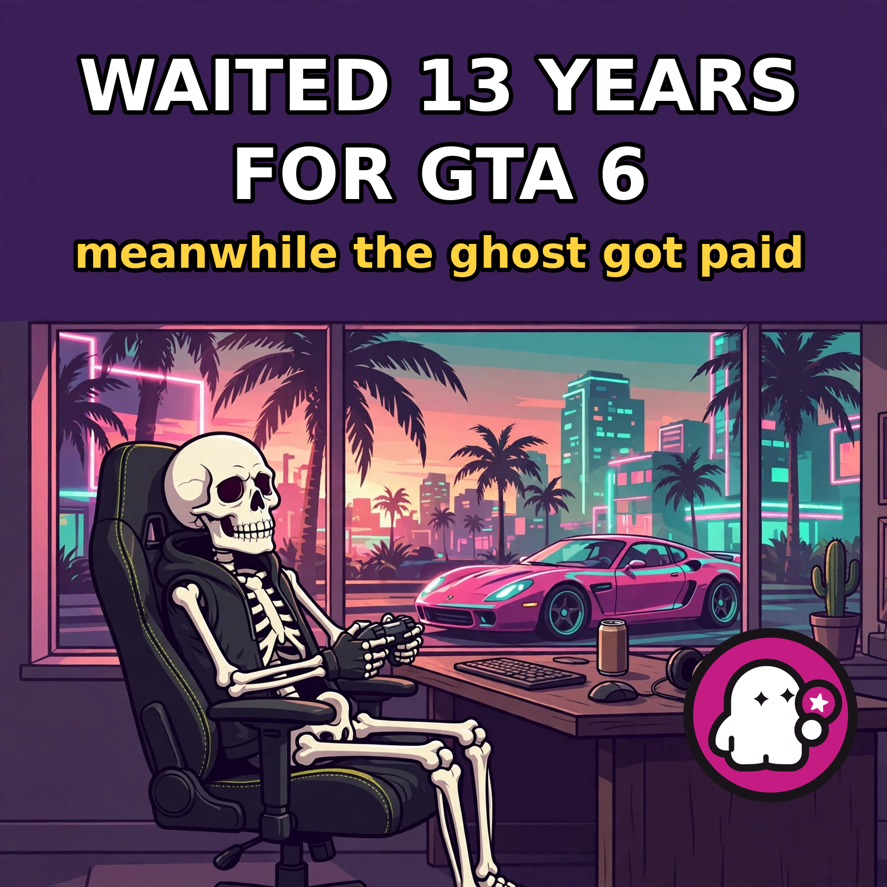

# GTA 6 meme on X — make.fun bounty entry

[](https://make.fun/bounty/gta6-meme-x-01)
[](https://make.fun/bounty/gta6-meme-x-01)
[](https://make.fun/profile)
[](https://x.com/tianchen996)

A GTA 6 meme for the make.fun bounty **gta6-meme-x-01** ($500, top 50 paid).

## The meme



A skeleton gamer who has waited 13 years for GTA 6, still holding his controller in front of a neon Vice City sunset — while the make.fun ghost sits on his desk, already paid. Caption: **"WAITED 13 YEARS FOR GTA 6 / meanwhile the ghost got paid"**.

The ghost is make.fun's real mascot, taken from the official press kit (https://make.fun/press/mark-1024.png).

## The post

Posted on X from the public account **@tianchen996**. The post's text carries the bounty page link, the play code `makefun-fishbowl-helium-urchin`, and the pitch that people and their AI agents can earn real money on make.fun. `POST.json` at the repo root holds the post's URL.

## How this repo works

`main.ts` (Node 22, standard library only) validates that `POST.json` holds a real X post URL and copies it to `/output/POST.json`, where the gate reads it. That is all the program has to do — the entry is the post itself.

Run it locally:

```sh
mkdir -p out && MAKEFUN_BOT_DIR=. MAKEFUN_OUTPUT_DIR=out node main.ts
```

## License

MIT — see [LICENSE](LICENSE).
